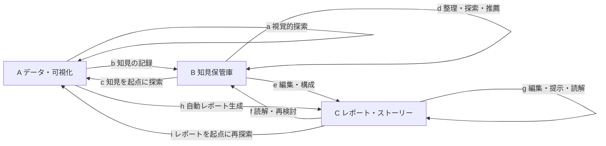

# 1. 論文の全体像・用語・循環モデル

## 1. 問題設定と貢献

[原典の整理：Abstract、§1、pp.1–3]

可視化は、単に図を提示するためではなく、データから知見を得るために使われる。しかしVisualization Insight研究は、定義、評価、注釈、知見抽出、自動ストーリー生成などへ分散しており、それらを結び付けた俯瞰が不足していた。

論文は次の問いに取り組む。

- **RQ1：** 知見の定義・分類を超えて、どのような研究次元が発展したか。知見ベースの評価、発見プロセスの理解、アルゴリズム・ツールを含む。
- **RQ2：** 知見の理解・活用を進めるための主要課題と将来方向は何か。

主な貢献は、理論・実証・技術の体系化、発見から伝達までの反復的かつ協調的なモデル、今後の5研究方向である。論文は一般的なデータ解析の統計手法集でも、Agentのレポート作成手順書でもない。

導入のCO2排出量の例では、極大・極小の年を知るだけでは数値情報にとどまる。対象年の出来事などと関連付けて初めて、領域について考え学ぶ材料になる。ただし、出来事と値を結び付ける説明の妥当性は別途検討が必要であり、図上の一致だけで原因を証明できるわけではない。

## 2. レビュー手法

[原典の整理：§3、pp.4–7、Appendix A–D、pp.36–37]

### 2.1 対象と収集

- 起点は、知見の定義・評価・ツール・採掘などを扱う高被引用の代表論文15件。
- 対象分野はVisualization、HCI、Databasesの3分野、主要な17ジャーナル・会議。
- 検索対象の期間は2005年1月〜2024年6月。早期公開、短報、extended abstractも対象に含める。
- タイトル検索語は `insight`、`annotation`、`knowledge`、`storytelling`、`report`、`fact`、`data story`、`note-taking`、`comment`。
- 会場ごとに本文またはキーワード中の `visualization` を追加条件とする。SIGMOD/VLDBでは本文、HCIとその他のDB系ではキーワードを利用する。
- タイトルや引用関係から検索語を反復的に更新し、後方・前方引用探索も行った。
- PRISMA 2020を参考に手順を報告。340件をタイトル・要旨で確認して223件を除外、117件を全文確認して25件を除外、92件を採用した。

したがって、**340件すべてを詳細レビューしたのではなく、詳細分析は92件**である。また、論文自体は2026年刊行であり、本文には検索期間後のLLM関連研究などへの言及もある。2026年時点の全研究を網羅したレビューとは読まない。

### 2.2 採否の考え方

採用対象は、知見を定義・分類する研究、知見・知識生成をモデル化する研究、何をどう発見するかの研究、ノート・注釈・テキストと図の接続、ファクト採掘・レポート生成などである。

除外対象には、発見や知見による評価を扱わない可視化設計、ストーリー内容を扱わない表現設計、テキスト分析そのもの、発見支援ではなくドメイン知識の入力のみを主題とする研究などが含まれる。よって、このレビューの採否を「可視化研究全般の優劣」と解釈してはいけない。

### 2.3 コーディング

3軸で分類する。

| 軸 | 内容 |
|---|---|
| 知見の水準 | データへの知見／ドメインへの知見 |
| 貢献 | 理論／実証／技術。複数該当し得る |
| 研究トピック | 理論2、実証5、技術9の合計16トピック |

ドメイン水準には、文脈を明示的に扱う研究に加え、ノートやthink-aloudを通じて利用者が領域知識を持ち込める研究も含まれる。したがって、分類表で「ドメイン」に該当することは、自動処理がドメイン理解を達成した証拠ではない。

2名が最初の15件を独立に分類し、貢献分類は一致したが、トピック集合の平均Jaccard類似度は0.46だった。議論・基準改訂後、別の25件で0.70となり、再議論して残りを1名が分類した。これらは分類の一貫性の指標であり、知見生成の精度ではない。

## 3. 主要用語

[原典の整理：§2.1、pp.3–4]

| 用語 | 内容 | レポートでの意味 |
|---|---|---|
| Visualization insight | 利用者の知識・理解が変化し、解釈や分析が前進すること | 出力項目数ではなく、何が分かったかを問う |
| Insight into the visualization | 凡例・符号化など、図の読み方の理解 | データの理解と混同しない |
| Insight into the data / Data fact | 相関、傾向、外れ値など、データについて分かること | 観測・集計の記述 |
| Insight into the domain | 対象領域の理解を変える知見 | 文脈と結び付けた意味づけ |
| Visual Data Exploration（VDE） | 視覚的表現との相互作用によってデータから知見を取り出す過程 | 探索・比較・絞り込み・仮説検討 |
| Insight externalization | 知見の意味を捉えて記録すること | 発見を後から追える成果物にする |
| Annotation | 図に埋め込まれた視覚的印やテキスト | 点・範囲・傾向などとの対応を示す |
| Note | VDEの空間と別に収集する文章や描画 | 独立した分析メモ |
| Data story / storytelling | 複数の知見を論理的・構造的につなぎ、意味のある物語として伝えること | 結果の単純な列挙を超える構成 |

### 3.1 ファクトとドメイン知見の区別

[応用案：以下は説明用の架空例]

- 図の理解：「横軸は月、縦軸は売上額である」。
- データファクト：「第2四半期の売上額が第1四半期より増えた」。
- ドメインに関する解釈候補：「販促施策の効果が出た可能性がある」。
- 検証課題：「季節性、価格変更、顧客構成の変化を考慮しても、その解釈が維持されるか」。

`data facts + domain information = insights into the domain` はFigure 1の概念的な説明である。文脈を付記するだけで解釈の正しさや因果関係が保証されるという数式ではない。

## 4. Figure 1：知見の生成・管理・伝達をつなぐモデル

[原典の整理：Figure 1、p.3、§5、pp.23–24]

### 4.1 A・B・Cと、その条件D

| 要素 | 意味 | 保存・操作されるもの |
|---|---|---|
| A：Data / Visualization | データと可視化を使って探索する状態 | データ、図、選択範囲、変換・分析状態 |
| B：Insight repository | 知見を外在化し、整理・探索・推薦する状態 | データファクト、ドメイン情報、関係、注釈など |
| C：Report / Presentation / Story | 知見を論理的につないで伝達する状態 | レポート、プレゼン、データストーリー |
| D：People and devices | A〜Cの活動を取り巻く利用条件 | 人数、役割、同期・非同期、画面、入力手段など |

原図の説明では4 statesと呼ぶが、DはA〜Cと同列の保存先ではなく、それらを取り囲む条件として描かれる。図は画面領域の分割を意味しない。たとえばBの注釈探索を、Aの可視化上で行ってもよい。

この図は原図の遷移を日本語で再整理したもの。Dの利用者・装置条件は全ノード・遷移に関わる。

### 4.2 9つの遷移

| 記号 | 方向 | 原典の例 | Agentへの対応案 |
|---|---|---|---|
| a | A→A | VDE | 切り口変更、図の比較、追加集計 |
| b | A→B | 知見の外在化 | 発見・根拠・条件を記録 |
| c | B→A | 知見に基づくVDE | 仮説、反証、例外を確かめる |
| d | B→B | 探索、コメント、推薦 | 横断整理、重複統合、関係づけ |
| e | B→C | レポート執筆、ストーリー・ダッシュボード生成 | 読者の問いに沿って編集 |
| f | C→B | ストーリーから知見を得る | レビューで得た新しい解釈を記録 |
| g | C→C | 編集、スタイル変更、発表、読解 | 構成、注釈、読みやすさの調整 |
| h | A→C | 自動レポート・ストーリー生成 | 分析結果から直接草稿を生成 |
| i | C→A | データストーリーを動機とするVDE | 草稿の疑問から解析へ戻る |

同じ矢印でも役割により意味が異なる。fは、読者が新しい知見を得る場合も、著者が他のストーリー部品を求めて保管庫へ戻る場合もある。cも、追加探索だけでなく、ある知見を表すのに適した図を選ぶ場合がある。

### 4.3 このモデルが追加する視点

知見を人の頭の中の出来事だけとして扱わず、外部成果物を通じて残し、組み替え、他者へ伝える過程として扱う。解析者、著者、読者、引き継ぎ相手などの役割を含め、単線的な「解析→結論」を避ける設計を説明できる。

ただし、モデルはシステムの機能範囲や遷移を記述する枠組みである。すべての課題で9遷移を実装すべきという要件や、最適な処理順序を与えるアルゴリズムではない。

## 5. 既存モデルとの関係

[原典の整理：§4.1.2、pp.8–9、§5.1、pp.23–24]

| モデル | 中心的な視点 | 本論文との関係 |
|---|---|---|
| van Wijkの可視化モデル | 図との相互作用で知識が増える。既有知識、認知能力、知覚が関わる | 本論文は外在化・伝達までを不可欠な部分として強調 |
| Pirolli & Cardのsensemaking | 情報収集→証拠整理→仮説構築というbottom-upと、構造再検討→追加証拠探索というtop-down | 本論文も両方向の反復を捉え、可視化とレポートの直接接続を含める |
| Sachaらの知識生成 | 探索、検証、知識生成の3ループ | 本論文は内部認知に加えて、知見保管庫やレポートなど外部成果物を前面に出す |
| Greenらのmixed-initiativeモデル | 情報探索、知識生成、仮説生成・分析が非線形に関連 | 本論文の非線形性と対応する |
| Andrienkoらのmodel building | 対象についてのモデルを反復的に構築・評価し、来歴を残し、外在化する | 知見は孤立した項目ではなく、理解と推論を伝える関係構造として扱う |

[応用案]

Agentには「解析結果を書く」だけでなく、「途中の理解を成果物として残す」「説明の不備から解析へ戻る」能力を持たせる。内部思考の逐語的記録ではなく、実行した変換、採用判断、根拠、保留理由といった検証可能な記録を残すと実装しやすい。
